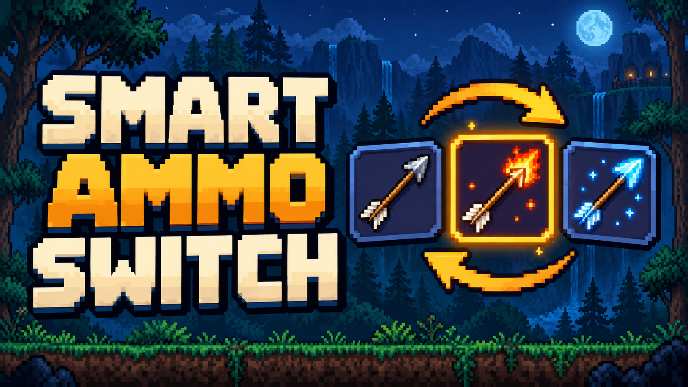

# Smart Ammo Switch



**Cycle through compatible ammo types without manually rearranging your inventory.**

Smart Ammo Switch lets you cycle forward and backward through ammunition compatible with the weapon you are holding. Use the in-game Filter Editor to choose which ammo types to include in the cycle.

## Features

- Cycle between compatible ammunition types with dedicated hotkeys.
- Search the four dedicated ammo slots or the whole inventory.
- Keep a stable cycling order while responding to inventory and manual layout changes.
- Use optional Blacklist or Whitelist filtering.
- Manage ammunition in a searchable catalog with category icons, item previews, and bulk actions.
- Optionally show the selected ammo type in chat.

## How it works

When you press a cycling key, the mod looks for a different ammo type for your held weapon.

1. The mod finds ammunition compatible with the held weapon in the configured search area.
2. It excludes ammunition blocked by the active filter.
3. It chooses the next or previous available ammo type.
4. If needed, it swaps the chosen stack with the stack Terraria currently selects for the held weapon.

For whole-inventory search, the initial cycling order prioritizes the dedicated ammo slots for regular ammunition and the coin slots for the Coin Gun. Coin Gun cycling requires whole-inventory search. Cycling can rearrange ammo stacks to make the selected type active.

The mod respects Terraria's ammo cycling accessories. Further shots or pauses can change which ammo Terraria selects according to the game's normal rules. In ammo-slots-only mode, switching pauses if Terraria selects a stack from the main inventory. Use whole-inventory search to switch from that stack.

No switch occurs when the held weapon does not use ammunition, no compatible ammo is available, the filter blocks all compatible types, or only one usable type remains.

If several types are allowed and the active type is blocked, **Next Ammo** selects the first allowed type and **Prev Ammo** selects the last. Entering a world starts a fresh cycle using that character's inventory.

## Ammo filtering

Open the **Filter Editor** with **Alt + C** by default. Choose one of three modes.

- **Disabled** — all compatible ammunition is allowed; saved selections are retained.
- **Blacklist** — selected ammunition is excluded from cycling.
- **Whitelist** — only selected ammunition is allowed. An empty whitelist blocks ammo switching by the mod.

The active mode button displays the selected-item count. In Disabled mode, the count is shown as saved selections.

The editor provides two views: **Catalog** for supported ammunition and **Selected** for items already in the filter. Search by name, item ID, or category, then use the category tabs (arrows, bullets, rockets, darts, coins, flares, sand, solution, or other) to narrow the results. Categories use item icons where available. Rows show an item icon and selection checkbox, with item details in tooltips.

Bulk actions apply to every result matching the current search and category. The selected category stays active when its last match disappears. **Select results** and **Clear results** are disabled while the results are empty.

- **Select results** (Catalog) adds every matching item to the selection.
- **Clear results** (Selected) removes the matching selected items.
- **Clear all** removes all selections, regardless of the current search or category.

You can drag the Filter Editor by its header or use **Pin** to prevent Escape from closing the window. When Search has keyboard focus, Escape releases that focus first. You can still close a pinned window with its close button or the Filter Editor keybind. Pin resets when the window is closed and reopened.

## Controls

Default keybinds

- **X** — Next Ammo.
- **Z** — Previous Ammo.
- **Alt + C** — Open Filter UI (open or close the Filter Editor).

Keybinds can be configured through TerrariaModder.

## Settings

Press **F6** and select **Smart Ammo Switch** to open its settings.

- **Show Messages** displays the selected ammo type in chat when you switch. It is on by default.
- **Search Mode** sets where the mod looks for ammunition. Choose **1** for the whole inventory (the default) or **2** for the four dedicated ammo slots.
- **Ammo Filter Mode** defaults to **Disabled**. Use the [Filter Editor](#ammo-filtering) to choose a mode.
- **Filtered Ammo Item IDs** stores the ammunition selected in the Filter Editor. The list starts empty.

## Requirements

- **Terraria 1.4.6** for Windows.
- **TerrariaModder Core 0.4.3 or newer.** Choose a compatible Core release from [Nexus Mods](https://www.nexusmods.com/terraria/mods/135?tab=files) or [GitHub Releases](https://github.com/Inidar1/terraria-modder/releases).
- [.NET Framework 4.8 Runtime](https://dotnet.microsoft.com/en-us/download/dotnet-framework/net48).

## Installation

1. Close Terraria and install any missing dependencies listed under [Requirements](#requirements). For a manual TerrariaModder Core installation, extract the Core archive into the folder containing `Terraria.exe`.
2. Download the Smart Ammo Switch archive for your Terraria version.

   - On [Nexus Mods](https://www.nexusmods.com/terraria/mods/170?tab=files), select **Manual download** for the main file.
   - On the [latest GitHub release](https://github.com/EscarvalOokt/SmartAmmoSwitch/releases/latest), download the packaged mod from **Assets**.

3. In your Terraria installation folder, open `TerrariaModder\mods\`. Create the `mods` folder if needed.
4. Open the mod archive and copy its `smart-ammo-switch` folder into `mods`. When updating, replace the existing `SmartAmmoSwitch.dll` and `manifest.json` with the copies from the new archive.
5. Run `TerrariaInjector.exe` from the folder containing `Terraria.exe`, or launch the modded game from TerrariaModder Vault.
6. Enter a world and press **Alt + C** to open the Filter Editor.

After installation, the mod files should be in the following locations.

```text
Terraria\
├── Terraria.exe
├── TerrariaInjector.exe
└── TerrariaModder\
    └── mods\
        └── smart-ammo-switch\
            ├── SmartAmmoSwitch.dll
            └── manifest.json
```

## Compatibility

### Existing characters and worlds

You can use Smart Ammo Switch with an existing character and world.

### Removing the mod

Close Terraria and remove the `smart-ammo-switch` folder from `TerrariaModder\mods\`. You can continue playing with the same character and world without save cleanup.

### Multiplayer

Ammo switching acts on the local player's inventory. Multiplayer synchronization has not been separately verified.

### Saved progress

Terraria saves the positions of your ammo stacks with your character, including swaps made by the mod. The cycle itself stays in memory. TerrariaModder saves your settings, including the filter mode and selected ammo IDs.

### Other mods

Ammo switching works with weapons and ammunition that use Terraria's standard ammo selection. A weapon that chooses its ammunition through a custom system may behave differently.

## Technical documentation

- [Development guide](docs/development.md)
- [Architecture](docs/architecture.md)
- [Testing policy](docs/testing.md)